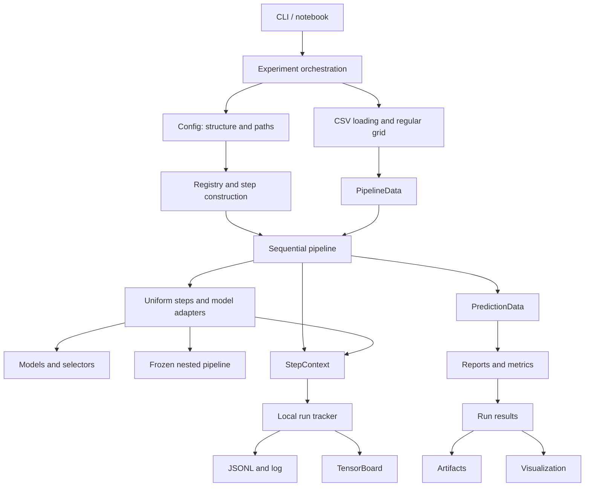

# Project restructuring: agreed architecture and implementation plan

Status: implemented. This document records the agreed design and the migration decisions.
The project now uses the single ordered pipeline schema described below.

## Decisions and scope

- Use a small project-owned pipeline with a uniform data container and step interface.
- A single ordered `pipeline` list in YAML defines transformations and the final model.
- Remove global `task: forecast | reconstruction` and task-specific experiment branches.
- Autoencoder `mode: reconstruct | encode` selects its output. Both modes train by
  reconstructing X; external y is not required.
- Exclusions, target alignment, window construction, scaling, selection and encoding
  are pipeline steps, rather than operations hard-coded in the experiment runner.
- Support extending steps and models through a registry and Python API. Do not add
  a general task/plugin framework or class-specific order restrictions.
- Migrate all project configs and notebooks. Old YAML schemas and pickle artifacts
  do not require compatibility; models can be trained again.
- Preserve user hyperparameters, selected features and excluded intervals.
- Make torch, matplotlib and TensorBoard required dependencies; remove extras and
  dependency-availability test skips. Lazy loading is no longer a requirement.
- Implement in complete, tested stages. The user explicitly approved an exception
  to AGENTS.md's stop-and-ask-after-each-source-file rule for this restructuring.

## Architecture before restructuring and its problems

| Module | Current responsibility and dependencies |
| --- | --- |
| `__init__`, `__main__`, `cli` | Public API and CLI entrypoints into experiment execution. |
| `config` | YAML, paths, defaults, validation; depends on factory and saved-AE details. |
| `factory` | Registries, cloning, early validation, row/window sklearn pipelines. |
| `data` | CSV loading, numeric values, regular grids, target alignment, exclusions. |
| `temporal` | Boundaries, aligned targets, train origins, forecast/reconstruction windows. |
| `experiment` | Loading, preprocessing, windows, window transforms, target scaling,
  fitting, reports, run classes and prediction preparation. |
| `models/ridge` | Flattened-window Ridge adapter. |
| `models/gru` | GRU architecture and sklearn adapter using TorchModelRunner. |
| `models/autoencoder` | Convolutional AE, encode/decode and sklearn adapter. |
| `models/base` | Torch training, checkpoint selection, history and batched prediction. |
| `models/pretrained` | AE export, scaler storage and context-specific frozen reuse. |
| `selectors/selection` | Static, ElasticNet and PLS selection with feature metadata. |
| `evaluation` | Regression and endpoint reconstruction metrics. |
| `artifacts` | Run directories, hashes, versions, JSON/YAML/CSV/pickle. |
| `visualization` | History and prediction plots. |
| configs/notebooks/scripts | Experiment settings, invocation and explicit test evaluation. |

The current config only orders steps inside `features` and `window_features`.
The experiment runner inserts windows and target handling between them. Prediction
repeats preparation logic. Frozen AE reuse substitutes its saved scaler through a
special runner branch. Parameter checks repeat across config, factory, estimators
and runner. These responsibilities are to be disentangled.

## Target dependencies



Implemented source layout:

```text
feature_selector/
    __init__.py, __main__.py, cli.py
    config.py, factory.py, data.py
    temporal.py       # shared split boundary calculation
    pipeline/
        data.py       # PipelineData, PredictionData, temporal context
        base.py       # uniform step interface
        core.py       # fit/transform/predict and inverse prediction path
        temporal.py   # exclusions, align_target, windows
        adapters.py   # sklearn transformers, target scaler, models
        frozen.py     # saved nested pipeline
    tracking/
        core.py       # scoped context, JSONL, readable logs, TensorBoard
    models/           # numerical algorithms and TorchModelRunner
    selectors/        # selection algorithms
    experiment.py     # run orchestration only
    results.py        # run state and repeated prediction
    evaluation.py     # report construction and metrics
    artifacts.py      # run and nested-pipeline persistence
    visualization.py  # plots from reports/history
```

Algorithms do not import config, experiments or results. Pipeline core does not
import concrete models. The old temporal responsibilities are redistributed to
data preparation and temporal steps; the old special pretrained mechanism is removed.

## Data contract

`PipelineData` contains:

- X: DataFrame or ndarray;
- y: Series, ndarray or None; sparse targets are allowed;
- one metadata row per example: origin_time, target_time, split, example/input exclusions and
  history_start/history_end;
- ordered feature names;
- temporal context: fixed frequency and split boundaries.

Before windowing, an example is a regular-grid row. Afterwards, it is a window.
Any step changing order/count updates X, y and sample metadata together. Do not
perform full validation whenever constructing this container.

`PredictionData` contains predicted values, optional reference values, corresponding
sample metadata, feature names and output meaning (target, features or latent).
The model determines its reference: regressors use y, reconstruction uses X.
Evaluation consumes this result without a global task switch. Without a reference,
produce predictions but no metrics.

## Step and pipeline contract

```python
fit(train: PipelineData, validation: PipelineData | None = None,
    *, context: StepContext | None = None) -> Self
transform(data: PipelineData, *, context: StepContext | None = None) -> PipelineData
```

Stateless fit returns self. sklearn algorithms use small adapters. A final model
also exposes predict returning PredictionData. The executor calls the same methods
regardless of the concrete transformation class.

During fit, for each step:

1. Select current train and validation representations.
2. Call step.fit(train, validation, context=...).
3. Transform the full temporal representation through the fitted step.
4. Pass the transformed result to the next step.

This preserves earlier history for validation windows. Test never enters fit,
validation loss or checkpoint selection. Causality and sensible ordering are the
pipeline author's responsibility; avoid hard-coded lists of allowed combinations.

At inference, reuse the same sequential transforms, with no duplicate preparation
implementation in run classes. Walk applicable steps backwards to restore both
target predictions and target references to the original units. For feature
reconstruction, restore predictions through the inverse path, then attach actual
observations from a snapshot of the original input using origin times and feature
names. Do not decode a latent reference: a lossy encoder would change the ground truth.

## Temporal processing and training semantics

- `exclude_intervals(intervals)` masks values and records exclusions without
  compressing the grid. Intervals are inclusive. Account for input history and
  aligned target time; for windows, detect history overlap. Repeated exclusions
  are idempotent. Track affected examples per split.
- `align_target(horizon)` shifts y and target metadata, updates split membership,
  preserves X, and also supports missing y for future prediction. Operates on rows.
- `windows(lookback)` constructs causal 3D feature histories, carries aligned y and
  metadata, rejects insufficient history, excluded history/targets and invalid
  features. Missing y alone does not reject a window. Track candidate, accepted
  and first-rejection counts by split. Never compress gaps.
- A scaler before align_target fits on original train rows. It does not inspect
  parameters of later steps.
- An AE fits all suitable train windows regardless of y. A regressor/learned
  selector selects known targets at its own algorithm boundary.
- Split membership follows target time after alignment. History can cross the
  preceding split boundary. Do not introduce a purge gap in this restructuring.
- Reconstruction loss uses full model-input windows; reported reconstruction
  metrics use last-window points in original units, pooled and per feature.

## Configuration and frozen encoder

Replace `features`, `window`, `window_features`, `target_scaler`, `model` and `task`
with one pipeline list. Keep data-source, split and run settings outside it.

AE example:

```yaml
data:
  features_path: ../datasets/uzk/uzk.csv
  freq: 1h
split:
  train_fraction: 0.6
  validation_fraction: 0.2
pipeline:
  - name: exclusions
    type: exclude_intervals
    params:
      intervals:
        - ['2022-10-01', '2022-10-16 23:00:00']
  - name: scaler
    type: standard
  - name: windows
    type: windows
    params: {lookback: 48}
  - name: autoencoder
    type: conv_autoencoder
    params: {mode: reconstruct, latent_channels: 8, epochs: 200}
run:
  output_dir: ../runs
```

Export a fitted prefix and AE encoding operation:

```python
run.pipeline.export_transform('runs/uzk_encoder.pkl',
                              through='autoencoder', mode='encode')
```

Change the exported copy's mode without changing the source model. The export
contains fitted preprocessing, exclusions, window construction, encoder and
training provenance. A GRU pipeline becomes:

```text
align_target -> frozen_pipeline(path=...) -> target_scale -> gru
```

The frozen step performs only transforms, carries current y/metadata, and never
refits its scaler or weights. Validate feature schema and frequency on use; retain
training boundaries as provenance, but do not require equal experiment splits.
The pipeline author is responsible for acceptable pretraining periods. Saved full
runs embed frozen state so they remain usable if the source export is removed.

The registry maps names to constructors/adapters. Python registration is sufficient;
no automatic plugin discovery is required. Validate names and final prediction
capability, not class-specific pipeline orders.
Saved Python `(name, Step)` specifications use `name`, `class`, `params` mappings
instead of YAML lists. Their top-level estimator classes must be importable;
nested estimators use the same class/params representation. Normal registry configs
continue to use type/params.

## Metadata ownership

| Information | Owner/storage |
| --- | --- |
| Time, targets, exclusions, feature identities | PipelineData, updated by transforming step |
| Weights, scalers, selected positions | Fitted step, serialized with pipeline |
| Config, input paths/hashes, versions, boundaries | Run orchestrator and metadata.json |
| Lifecycle, shapes, duration, errors | Executor events |
| Window rejections, selected features, checkpoint | Step-scoped metadata/events |
| Batch/epoch losses and learning rate | Runner events and model history_ |

Steps may write their diagnostics in their own namespace, never mutate a global
metadata dictionary owned by another step. Large arrays/tables are artifacts, not
event payloads. Do not duplicate data values or full per-example metadata in logs.

## Logging and tracker contract

Pass an optional StepContext per invocation, not as an estimator constructor
parameter or fitted attribute. Context binds a tracker to a nested step path and
operation. Without context, algorithms remain usable with a no-op tracker.

Scoped API:

```python
log_metrics(values, *, split=None, epoch=None, batch=None, step=None, samples=None)
log_metadata(values)
log_event(name, values)
log_message(message, *, level='info')
```

The executor logs start/end, elapsed time, input/output shapes and errors. Steps
log only algorithm-specific facts; plain scalers need no custom logging. The runner
logs learning progress. Writers/handlers/directories are owned by the run tracker.
Nested steps use paths such as `pipeline/encoder/windows`.

Required model telemetry:

- Every completed train batch: epoch, batch number, global optimizer step, actual
  example count, pre-update loss and current learning rate.
- Every epoch: sample-weighted mean train loss, validation loss when validation
  exists, and epoch number.
- Completion: best epoch, stopping reason and checkpoint restoration.
- Without validation, validation_loss and best_epoch are None; all epochs run and
  final weights remain.

Compute losses once, update model.history_ and emit the same values. Training loss
uses training units; original-unit evaluation metrics are separate. Existing history
and plots remain accessible after reloading. Frozen histories are provenance, not
new training events.

Run outputs:

```text
config.yaml
metadata.json
events.jsonl
run.log
tensorboard/
predictions_*.csv
metrics.json
run.pkl
```

JSONL events are flushed after each record to preserve completed batches on failure.
TensorBoard tags include step path, split and batch/epoch scope. Batch metrics use
monotonic optimizer steps; epoch metrics use epoch coordinates. Close/flush outputs
on success and exception. No background queues or remote tracking service are needed.

## Validation boundaries

- Config: YAML shape, required sections, names and paths; do not construct models
  just to prevalidate their arguments.
- Factory: resolve constructor and pass params; attach step name while retaining
  original exception cause. Do not call `_validate_params` preemptively.
- Loader: grid correctness, duplicate timestamps, source alignment, numeric values.
- Step: essential input conditions for its operation.
- Model adapter: select suitable examples, shape and fitted schema.
- sklearn/PyTorch: own parameter/optimizer/device constraints; a negative learning
  rate can fail when optimizer construction actually consumes it.
- Metrics: prediction/reference alignment and definedness.

Missing target references are excluded from metrics; nonfinite predictions are errors,
including predictions for currently unlabelled examples. Do not improve scores by
silently dropping invalid model outputs.

Keep checks preventing silent errors (schema order, alignment, shape broadcasting,
empty training loops). Remove repeated exhaustive type/range checks and repeated
whole-array scans after every step.

## Implementation stages and acceptance checks

1. Document architecture and contracts; implement containers and temporal selection.
2. Implement uniform executor, scoped tracker, JSONL and TensorBoard.
3. Implement temporal steps and adapters; move windows/exclusions out of experiment.
4. Integrate model modes, runner telemetry and frozen nested pipeline export.
5. Simplify experiments/results/evaluation/artifacts and remove task branches.
6. Migrate all configs, four notebooks, script integration, docs, dependencies and tests.

Checks:

- Known windows/horizons; gaps, intervals and split-boundary history.
- Missing y does not shrink AE training; supervised models select observed targets.
- Scaler-before-alignment uses original train rows; validation/test are not fitted.
- One event per completed train batch and validation metric per applicable epoch.
- Batch records, weighted epoch means, JSONL and TensorBoard agree.
- Interrupted fit retains readable events; scoped metadata cannot overwrite siblings.
- Frozen preprocessing/weights do not update; reload works without source export.
- Original-unit predictions and reconstruction references survive save/load.
- User-defined step works without changes to executor/config logic.
- Validation-disabled training keeps final weights and no selected epoch.
- Full unittest, short CPU Ridge/GRU/AE runs, AE/GRU notebook execution, lockfile
  consistency, wheel contents and imports from the built package.

The pre-migration baseline passed 89 CPU tests. GPU and Pylance were not checked.
Old-schema tests must migrate rather than force runtime compatibility. Preserve
user-selected eight reconstruction plots:
81TI10143, 81TI10126, 81FIL30066, 81LILH40012,
81TIH11209, 81FCL30063, 81FI30052, 81TI10123.

## Implementation verification

- The migrated test suite passed 67 tests on CPU, covering numerical models, temporal steps, adapters, frozen
  prefixes, configuration, CLI, persistence, plots and live telemetry.
- Four notebooks were executed on shortened real UZK/DataSet1 inputs with one epoch.
  UZK used 289 input features; AE pretraining saw 425 windows versus 25 labelled
  windows for the GRU. AE.fit was forbidden during the frozen-GRU notebook run.
- Runtime dependencies are mandatory; model history and JSONL/TensorBoard metrics
  are tested against the same computed loss values.
- New inference reports may contain future/unobserved targets with y_true=NaN;
  metrics only count finite observed references. This is intentional.
- CPU verification does not imply GPU or Pylance verification.

The lockfile and build were checked; the extracted wheel executed AE training,
transform export, frozen-prefix forecasting and reload without the source export.

## Review corrections

- Reconstruction reports preserve actual original observations across ordinary and
  frozen encoder chains. Lossy decoder output is never used as the ground truth.
- Nonfinite predictions fail evaluation rather than silently reducing metric counts.
- Intermediate model transforms validate the fitted feature order, like predict.
- Saved configs round-trip Python steps and nested estimators through importable
  class/params descriptions; Python component paths use the configuration base.
- The redundant public reconstruct method was removed. encode/decode remain explicit;
  predict/transform/fit_transform return the representation selected by mode.
- After these corrections, 73 CPU tests passed. All four notebooks were exercised
  on shortened real inputs again.

## Training telemetry and final reports

TensorBoard contains batch/epoch losses and learning rates for neural models.
Final metrics remain in metrics.json and configuration in config.yaml for every model.
No additional TensorBoard sessions or final-metric scalar events are generated.
