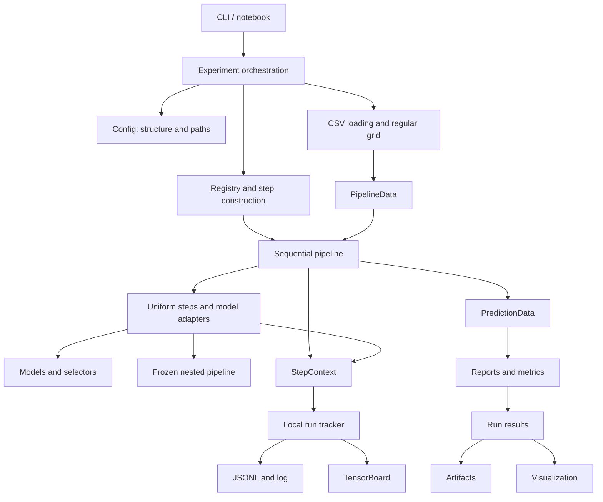

# Project architecture and contracts

This document describes the implemented architecture and data contracts.
Experiment hyperparameters and optional step choices belong to configurations,
not to the architectural contract. Code style is documented separately in
[code_style.md](code_style.md).

## Dependencies



Implemented source layout:

```text
feature_selector/
    __init__.py, __main__.py, cli.py
    config.py, factory.py, data.py
    temporal.py       # shared split boundary calculation
    pipeline/
        data.py       # PipelineData, PredictionData, temporal context
        base.py       # uniform step interface
        core.py       # fit/transform/predict and inverse prediction path
        temporal.py   # exclusions, align_target, windows
        filter.py     # target-only filtering, including future values
        adapters.py   # sklearn transformers, target scaler, models
        frozen.py     # saved nested pipeline
    tracking/
        core.py       # scoped context, JSONL, readable logs, TensorBoard
    models/           # numerical algorithms and TorchModelRunner
    selectors/        # selection algorithms
    experiment.py     # run orchestration only
    results.py        # run state and repeated prediction
    evaluation.py     # report construction and metrics
    artifacts.py      # run and nested-pipeline persistence
    visualization.py  # plots from reports/history
```

Algorithms do not import config, experiments or results. Pipeline core does not
import concrete models. Data preparation and temporal steps own grid and split processing.

## Data contract

`PipelineData` contains:

- X: DataFrame or ndarray;
- y: Series, ndarray or None; sparse targets are allowed;
- one metadata row per example: origin_time, target_time, split, example/input exclusions and
  history_start/history_end;
- ordered feature names;
- temporal context: fixed frequency and split boundaries.

Before windowing, an example is a regular-grid row. Afterwards, it is a window.
Any step changing order/count updates X, y and sample metadata together. Do not
perform full validation whenever constructing this container.

`PredictionData` contains predicted values, optional reference values, corresponding
sample metadata, feature names and output meaning (target, features or latent).
The model determines its reference: regressors use y, reconstruction uses X.
Evaluation consumes this result without a global task switch. Without a reference,
produce predictions but no metrics.

## Step and pipeline contract

```python
fit(train: PipelineData, validation: PipelineData | None = None,
    *, context: StepContext | None = None) -> Self
transform(data: PipelineData, *, context: StepContext | None = None) -> PipelineData
```

Stateless fit returns self. sklearn algorithms use small adapters. A final model
also exposes predict returning PredictionData. The executor calls the same methods
regardless of the concrete transformation class.

During fit, for each step:

1. Select current train and validation representations.
2. Call step.fit(train, validation, context=...).
3. For nonfinal steps, transform the full temporal representation through the fitted step.
4. Pass the transformed result to the next step.

This preserves earlier history for validation windows. Test examples never enter
step.fit, validation loss or checkpoint selection. Intermediate transforms receive
the full representation, including test. The target filter intentionally uses
all supplied targets in its statistics, so filtered training labels can depend on
later splits. Causality and sensible ordering are the pipeline author's responsibility;
avoid hard-coded lists of allowed combinations.

At inference, reuse the same sequential transforms, with no duplicate preparation
implementation in run classes. Walk applicable steps backwards to restore both
target predictions and target references to the original units. For feature
reconstruction, restore predictions through the inverse path, then attach actual
observations from a snapshot of the original input using origin times and feature
names. Do not decode a latent reference: a lossy encoder would change the ground truth.

## Temporal processing and training semantics

The runner always sets `drop_last=True` on its training DataLoader: the final
incomplete batch is discarded after each epoch's shuffle for all PyTorch models.
There is no estimator, runner-fit or YAML parameter for this behavior. At least
one full batch is required; otherwise fit raises ValueError before training.
Validation and inference retain all samples. Epoch train loss and its telemetry
sample count use the examples actually processed.

- `exclude_intervals(intervals)` masks values and records exclusions without
  compressing the grid. Intervals are inclusive. Account for input history and
  aligned target time; for windows, detect history overlap. Repeated exclusions
  are idempotent. Track affected examples per split.
- `filter(filter_freq, max_diff)` masks only y using the algorithm described
  below. It preserves X and the grid and is intentionally noncausal.
- `align_target(horizon)` shifts y and target metadata, updates split membership,
  preserves X, and also supports missing y for future prediction. Operates on rows.
- `windows(lookback)` constructs causal 3D feature histories, carries aligned y and
  metadata, rejects insufficient history, excluded history/targets and invalid
  features. Missing y alone does not reject a window. Track candidate, accepted
  and first-rejection counts by split. Never compress gaps.
- `temporal_pool(factor)` averages nonoverlapping groups of adjacent timesteps
  independently within each 3D NumPy window. The positive integer factor must
  divide the positive window length; factor 1 preserves length. Validation occurs
  at transform. Empty sample batches are supported; NaNs propagate within groups.
  Sample count/order, targets, feature names, history boundaries, split labels and
  original temporal context remain unchanged. Pooling does not resample the grid.
- A scaler before align_target fits on original train rows. It does not inspect
  parameters of later steps.
- An AE fits all suitable train windows regardless of y. A regressor/learned
  selector selects known targets at its own algorithm boundary.
- Split membership follows target time after alignment. History can cross the
  preceding split boundary. There is no additional purge gap.
- Reconstruction loss uses full model-input windows; reported reconstruction
  metrics use last-window points in original units, pooled and per feature.

## Configuration and frozen encoder

The top-level sections are `data`, `split`, `pipeline` and `run`.
Data-source, split and run settings stay outside the ordered pipeline list.

Run artifacts live in `<run.output_dir>/<run.experiment_name>/<local timestamp>/`.
`experiment_name` defaults to `default`.
Names must be nonblank single directory components, excluding `.` and `..`, path
separators and null characters. Timestamps use `YYYY-MM-DD_HH-MM-SS`; collisions
receive `_2`, `_3`, etc. Atomic directory creation prevents overwrite during concurrent
launches. Loggers are identified by resolved run paths to isolate experiments sharing
the same timestamp. Timestamp formats inside log records are unchanged.

AE example:

```yaml
data:
  features_path: ../datasets/uzk/uzk.csv
  freq: 1h
split:
  train_fraction: 0.6
  validation_fraction: 0.2
pipeline:
  - name: exclusions
    type: exclude_intervals
    params:
      intervals:
        - ['2022-10-01', '2022-10-16 23:00:00']
  - name: scaler
    type: standard
  - name: windows
    type: windows
    params: {lookback: 48}
  - name: autoencoder
    type: conv_autoencoder
    params: {mode: reconstruct, latent_channels: 8, epochs: 200}
run:
  output_dir: ../runs
  experiment_name: uzk_autoencoder_pretrain
```

Export a fitted prefix and AE encoding operation:

```python
run.pipeline.export_transform('runs/uzk_encoder.pkl',
                              through='autoencoder', mode='encode')
```

Change the exported copy's mode without changing the source model. The export
contains fitted preprocessing, exclusions, window construction, encoder and
training provenance. A GRU pipeline becomes:

```text
exclude_intervals -> filter -> align_target -> frozen_pipeline -> target_scale -> gru
```

The frozen step performs only transforms, carries current y/metadata, and never
refits its scaler or weights. Validate feature schema and frequency on use; retain
training boundaries as provenance, but do not require equal experiment splits.
The pipeline author is responsible for acceptable pretraining periods. Saved full
runs embed frozen state so they remain usable if the source export is removed.

The registry maps names to constructors/adapters. Python registration is sufficient;
no automatic plugin discovery is required. Validate names and final prediction
capability, not class-specific pipeline orders.
Saved Python `(name, Step)` specifications use `name`, `class`, `params` mappings
for persistence. Their top-level estimator classes must be importable;
nested estimators use the same class/params representation. Normal registry configs
continue to use type/params.

## Metadata ownership

| Information | Owner/storage |
| --- | --- |
| Time, targets, exclusions, feature identities | PipelineData, updated by transforming step |
| Weights, scalers, selected positions | Fitted step, serialized with pipeline |
| Config, input paths/hashes, versions, boundaries | Run orchestrator and metadata.json |
| Lifecycle, shapes, duration, errors | Executor events |
| Window rejections, selected features, checkpoint | Step-scoped metadata/events |
| Batch/epoch losses and learning rate | Runner events and model history_ |

Steps may write their diagnostics in their own namespace, never mutate a global
metadata dictionary owned by another step. Large arrays/tables are artifacts, not
event payloads. Do not duplicate data values or full per-example metadata in logs.

## Logging and tracker contract

Pass an optional StepContext per invocation, not as an estimator constructor
parameter or fitted attribute. Context binds a tracker to a nested step path and
operation. Without context, algorithms remain usable with a no-op tracker.

At run startup, before loading data or constructing the pipeline, `run.seed`
initializes process-wide Python, NumPy and PyTorch CPU/CUDA generators. The seed
defaults to zero and uses NumPy's integer range [0, 2**32 - 1]. Model-level
`random_state` parameters and explicit DataLoader generators remain independent
settings. The run seed is recorded in events, metadata and pipeline provenance.

Scoped API:

```python
log_metrics(values, *, split=None, epoch=None, batch=None, step=None, samples=None)
log_metadata(values)
log_event(name, values)
log_message(message, *, level='info')
```

The executor logs start/end, elapsed time, input/output shapes and errors. Steps
log only algorithm-specific facts; plain scalers need no custom logging. The runner
logs learning progress. Writers/handlers/directories are owned by the run tracker.
Nested steps use paths such as `pipeline/encoder/windows`.

Required model telemetry:

- Every completed train batch: epoch, batch number, global optimizer step, actual
  example count, pre-update loss and current learning rate.
- Every epoch: sample-weighted mean train loss, validation loss when validation
  exists, and epoch number. Train means remain in history and JSONL only;
  TensorBoard and the readable log omit epoch train loss.
- Completion: best epoch, stopping reason and checkpoint restoration.
- Without validation, validation_loss and best_epoch are None; all epochs run and
  final weights remain.

Compute losses once, update model.history_ and emit the same values. Training loss
uses training units; original-unit evaluation metrics are separate. Existing history
and plots remain accessible after reloading. Frozen histories are provenance, not
new training events.

Run outputs:

```text
config.yaml
metadata.json
events.jsonl
run.log
tensorboard/
history.json
features.json
predictions_*.csv
metrics.json
run.pkl
```

JSONL events are flushed after each record to preserve completed batches on failure.
TensorBoard tags include step path, split and batch/epoch scope. Train loss is
published per batch; validation loss is published per epoch. Batch metrics use
monotonic optimizer steps; epoch metrics use epoch coordinates. Close/flush outputs
on success and exception. Do not add project-owned background queues or remote tracking.

## Validation boundaries

- Config: YAML shape, required sections, names and paths; do not construct models
  just to prevalidate their arguments.
- Factory: resolve constructor and pass params; attach step name while retaining
  original exception cause. Do not call `_validate_params` preemptively.
- Loader: grid correctness, duplicate timestamps, source alignment, numeric values.
- Step: essential input conditions for its operation.
- Model adapter: select suitable examples, shape and fitted schema.
- sklearn/PyTorch: own parameter/optimizer/device constraints; a negative learning
  rate can fail when optimizer construction actually consumes it.
- Metrics: prediction/reference alignment and definedness.

Missing target references are excluded from metrics; nonfinite predictions are errors,
including predictions for currently unlabelled examples. Do not improve scores by
silently dropping invalid model outputs.

Regression reports include MAE, RMSE, MAPE in percent, R², Pearson correlation and
its two-sided p-value. Any observed zero target makes MAPE undefined, with NaN and
an explanation in notes; no observations are discarded for the other scores.
Undefined Pearson p-values use the same constant/insufficient-sample rules as
correlation. Reconstruction reports receive the same scores overall and per feature.

`evaluation.summarize_regression_metrics` summarizes a nonempty sequence of run
scores intended for the same evaluation examples. Each run has equal weight.
Each metric has mean, sample standard deviation (`ddof=1`), `n_valid` and `n_total`.
Nonfinite scores are excluded with visible coverage counts. Mean is NaN if no
finite scores exist; standard deviation is NaN with fewer than two. Summarizing
p-values is descriptive and does not combine their statistical significance.
This helper only aggregates supplied scores; it does not train or evaluate models.

`experiment.run_seed_experiments(config, seeds=tuple(range(10)))` explicitly evaluates
test after each scalar regression run. It returns `SeedExperimentResult` with
`artifact_dir`, `metrics_per_seed` and `metrics_summary` DataFrames. The terminal
estimator must expose `random_state`; the series overrides that parameter while
keeping `run.seed` fixed. Seeds are unique integers in [0, 2**32 - 1], used in order.
GRU ensembles interpret each seed as the first member seed. Reconstruction terminal
models and estimators without `random_state` are rejected.

Ensemble seed ranges can overlap across series runs: with ten members, base seeds
0 and 1 produce member seeds 0..9 and 1..10. With fixed preprocessing, overlapping
members repeat the same initialization and CPU training. To use disjoint member
seed ranges, supply base seeds spaced by n_estimators, for example 0, 10, ..., 90
for ten ten-member ensembles.

The first ordinary run fits the full pipeline and exports every step preceding the
terminal model, including target scaling, to `preprocessing.pkl`. Later runs use
`frozen_pipeline` with that prefix, so fitted feature/target preprocessing and any
intermediate encoders are shared without refitting. Each run remains self-contained
after serialization. Input hashes and test timestamps/references must match across
runs. Ordinary run execution, target filtering and train/validation fitting contracts
are unchanged; the series performs explicit test prediction and saves it afterwards.

The series directory is `<run.output_dir>/<run.experiment_name>/<local timestamp>/`.
Series artifacts include `metrics_per_seed.csv` (seed, scores, n, JSON notes and run
directory), `metrics_summary.csv` (metric, mean, std, n_valid, n_total), and `series.json`
(requested/completed seeds, status, run_seed and std_ddof). Completed runs under
`runs/seed_<seed>/<local timestamp>/` retain their usual artifacts plus test metrics
and predictions. Internal run configurations use `seed_<seed>` as their experiment name.
Run metadata and pipeline provenance record `model_seed` and `seed_series` separately
from the global seed. The series retains paths and score tables rather than all
trained models in memory. No seed or checkpoint is selected using test scores.

Tables are rewritten after each completed run. A failed run stops the series,
preserves completed results, marks series.json as failed and records failure.json.
Partial summary n_total counts completed runs; requested seeds remain in series.json.
An empty test partition or absent target source is rejected before training. No usable
observed test targets after preprocessing is an evaluation failure, not a skipped run.

Keep checks preventing silent errors (schema order, alignment, shape broadcasting,
empty training loops). Remove repeated exhaustive type/range checks and repeated
whole-array scans after every step.

## Acceptance checks

- Known windows/horizons; gaps, intervals and split-boundary history.
- Missing y does not shrink AE training; supervised models select observed targets.
- Scaler-before-alignment fits on original train rows, excluding validation/test from scaler.fit.
- One event per completed train batch and validation metric per applicable epoch.
- Batch and validation losses agree across history, JSONL and TensorBoard;
  weighted train epoch means agree across history and JSONL and are absent from TensorBoard.
- Interrupted fit retains readable events; scoped metadata cannot overwrite siblings.
- Frozen preprocessing/weights do not update; reload works without source export.
- Original-unit predictions and reconstruction references survive save/load.
- User-defined step works without changes to executor/config logic.
- Validation-disabled training keeps final weights and no selected epoch.
- Full unittest, short CPU Ridge/GRU/AE runs, AE/GRU notebook execution, lockfile
  consistency, wheel contents and imports from the built package.

## Training telemetry and final reports

TensorBoard contains train batch losses and learning rates, plus validation epoch losses.
Final metrics remain in metrics.json and configuration in config.yaml for every model.
Final train/validation MAE, RMSE, R², Pearson and n are also published as
results/{split}/{metric} scalars
and a results/summary text table in the same TensorBoard run. Reconstruction summaries
use overall scores in original units; per-feature scores remain in metrics.json.
Undefined scores are omitted from scalars and shown as unavailable in the table.
Ordinary `run_experiment` neither evaluates nor logs test automatically. The seed-series
API explicitly evaluates and saves test reports after those runs, without publishing
additional TensorBoard summaries. No additional sessions are created.

## Autoencoder feature projections

Autoencoders accept windows shaped `(samples, timesteps, features)`. Dense layers
project the last dimension using shared weights at every timestep.

`ConvAutoencoder(compression="features")` uses
`Linear -> GELU -> Linear` for both encoder and decoder. It preserves window length
and processes each timestep independently; latent outputs have no activation.
With `compression="features_time"`, the input projection is `Linear -> GELU`,
followed by a temporal convolution with kernel 3, stride 2, padding 1 and GELU.
The decoder interpolates to the fitted window length, applies a kernel-3 temporal
convolution with padding 1 and GELU, then projects back to features with `Linear`.

`GRUAutoencoder` uses `GRU -> Linear` for encoding and
`Linear -> GELU -> GRU -> Linear` for decoding. Both preserve temporal length;
the decoder starts a fresh recurrent state and receives only the latent sequence.
Training, output modes, batched inference and frozen-prefix reuse retain their
existing contracts.

`S4Autoencoder` uses unidirectional S4 (`mode="diag"`, S4D) with one independent
block in the encoder and one in the decoder. Both operate at input feature width
without external LayerNorm or an additive residual path. The encoder is
`S4(F) -> Linear(F, C)`; the decoder is
`Linear(C, F) -> GELU -> S4(F) -> Linear(F, F)`.
The latent sequence is `(samples, timesteps, latent_channels)`: only features are
compressed. Outputs use past and current points within each window. The decoder
receives only latents, with no encoder state or skip connection around the bottleneck.

The S4 state size is a positive even integer, configured with `state_size` and
defaulting to 64. It controls internal memory, independently of `latent_channels`.
The existing reconstruction/encoding modes, target-independent training, batched
inference and frozen-prefix contracts also apply to S4.

`S4Autoencoder.dropout` is a finite probability in `[0, 1)`, defaulting to `0.0`.
Both S4 blocks receive this probability with `tie_dropout=True`: each dropout site
shares its channel mask across the window's timesteps, with independent masks per
sample and site. Dropout acts inside FFTConv before its activation and inside S4Block
before its output projection. It is disabled during inference. `tie_dropout` is not
an estimator or YAML parameter.

The factory exposes S4 through `s4_autoencoder` with reconstruction-aware model
adaptation. `models/s4.py` is third-party library code, retained without project-style
refactoring. Its existing import of `rank_zero_only` requires `pytorch-lightning`.

S4 optimizer groups honor each parameter's `_optim` settings. Their initial rate
is `ssm_learning_rate` (0.001 unless configured); kernel parameters override weight
decay with zero except for C, which inherits the estimator's `weight_decay`.
Ordinary parameters use `learning_rate` and `weight_decay`, and their group stays
first for the runner's existing learning-rate telemetry. Cosine scheduling applies
the common `min_lr` to every group. Constructing existing autoencoders still uses
one AdamW parameter group with their original settings.

## GRU ensemble

`gru_ensemble` wraps `GRUEnsembleRegressor` in the existing `ModelStep`. The factory
only registers its constructor; pipeline execution and experiment orchestration
remain independent of the concrete model.

Members train sequentially on the same train windows with successive seeds.
All members receive the full validation pair for loss and checkpoint selection.
Setting `gru_params.patience >= gru_params.epochs` prevents an early exit while
retaining validation telemetry and best-weight selection. Ridge then fits on all
member predictions for that same validation set. Its input columns retain member
order at inference. Validation is required for Ridge; test never participates in fit.
The reported validation scores describe data used to train Ridge and select GRU weights;
they are not an independent evaluation of the final ensemble. Test evaluation remains explicit.

The composite has no shared epoch axis. Its `history_` contains one record per GRU
with `estimator`, `random_state`, `best_epoch` and the member's unchanged epoch
`history`. Individual histories and best epochs remain available on `estimators_`
for existing plots. `meta_model_` holds the fitted Ridge.

Member telemetry uses child paths `pipeline/model/gru_<index>` in the same tracker
and TensorBoard directory. Ridge coefficients and intercept belong to metadata at
`pipeline/model/ridge`. The ensemble does not open files or own a writer.
`notebooks/uzk/gru_ensemble.ipynb` shows member histories, combination coefficients and an
explicit test evaluation after loading the saved pipeline.

An ensemble can consume the output of a fitted encoder through `frozen_pipeline`.
The exported prefix supplies its fitted transformations without refitting. Saved
runs embed the prefix, and encoder histories remain pretraining provenance.
An optional `temporal_pool` after the frozen prefix changes latent window resolution
without retraining the encoder; the downstream model must be retrained.

## Target filtering

The `filter` registry entry constructs `TargetFilter`, a stateless project step.
It changes only external y, retaining X, rows and temporal metadata. Period means,
absolute first differences, resampling to the context frequency and nearest
interpolation define the filter statistic. Changes strictly greater than
`max_diff` mask targets with NaN. Future values and all splits in the supplied
batch participate in these statistics; the filter is intentionally noncausal.

Missing y is a no-op. Repeated exclusions inside a frozen prefix preserve existing
masks. The filter threshold uses the units of y at its position in the pipeline.

Supervised model adapters, Ridge stacking and target scaling consume only usable
observed targets. Predictions retain inputs with masked references; metrics count
the remaining observed references. Newly masked counts by split are step metadata,
not TensorBoard scalars. Masked labels do not exclude otherwise usable inputs.

## Prediction plots

Timeline plots sort each report by target time and independently omit missing truth
and predictions before drawing each curve. Lines connect the remaining points across
gaps; plotting does not fill values in reports or metrics. Ground truth uses a higher
z-order than predictions so observations remain visible when curves overlap.

## Configuration and notebook layout

Configurations live under `configs/`; notebooks are grouped under `notebooks/`.
`pretrain` identifies autoencoder training and export; other filenames identify
forecasting scenarios. `configs/example.yaml` demonstrates the configuration schema.
Experiment settings and exported artifact paths can change independently of this document.

YAML paths are relative to the configuration file. Notebook setup finds the project
root among the working directory and its parents using `pyproject.toml` and
`src/feature_selector`, then changes into that root. CLI examples assume the project
root as the working directory.

## Verification

Verification results are recorded here with their date and scope. GPU, Pylance,
full notebook execution and real-data training require separate checks.

On 2026-11-03, documentation and test independence from experimental YAMLs were
checked on CPU. The full unittest suite passed all 144 tests in 16.427 seconds.
Repository-config assertions were removed; S4 tied dropout is tested with explicit
estimator parameters, and pooling behavior retains numerical and integration coverage.
No source algorithms, third-party S4 code or experimental configurations were changed.
`pytorch-lightning` was restored because the unmodified S4 module imports it.
`uv lock --check`, `uv build` and `git diff --check` passed. The extracted wheel
passed isolated CLI import/help and a one-epoch S4 fit/predict smoke check on CPU.
Wheel contents include S4 and exclude tests, datasets and notebooks. GPU, Pylance,
full notebook execution and real-data training were not run.

On 2026-11-03, repository workflow changes were checked: the local branch is `dev`,
and Git clean/diff filters use the nbstripout development dependency. An alternate
Git index staged all 11 notebooks: the Git blobs contained no outputs or execution
counts, while SHA-256 checks confirmed every working notebook remained byte-identical
with all 133 outputs retained. Notebook cell sources/types and the real staging
index were unchanged. Working notebooks total 5,304,480 bytes; filtered blobs total
121,327 bytes. Setup is documented in notebooks.md; code style is in code_style.md.
`uv lock --check`, `uv build` and `git diff --check` passed. Runtime Python code was
not changed; the unittest suite was not repeated for these workflow/documentation edits.

On 2026-11-03, the final pre-commit check passed all 144 CPU tests in 13.959 seconds;
`git diff --check` passed and the notebook filter was installed on local branch dev.
One repository completeness issue remains: scripts/dataset1.py is ignored and
untracked, although the DataSet1 notebook imports it and README commands require it.
Tests currently pass using that local file; the tracked project alone does not
supply it to a fresh clone. No commit or history rewrite was performed.
