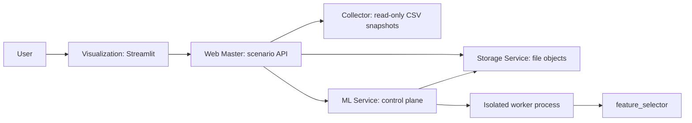

# Microservice system

The system supports research workflows for prediction from UZK temporal signals.
Its target user is a researcher who collects a dataset, trains Ridge or GRU,
applies a saved model and compares experiments. The numerical core and its
CLI/notebooks work independently of the services.

The five containers are Collector, Storage, ML Service, Web Master and
Visualization. Streamlit provides the GUI; FastAPI provides the APIs. Storage
holds CSV, pickle and JSON manifests without a database. Services do not share
a data directory. The interface, application messages, logs and default names
are in English. User-provided names and source data are preserved without
translation. Detailed contracts are in the [service architecture section](#service-architecture).

## Data preparation

Source data is **not included in the Git repository** and must be supplied to
the reviewer separately. Prepare the following directory layout:

```text
datasets/
└── uzk/
    ├── uzk.csv
    └── uzk_lab.csv
```

`uzk.csv` contains features; `uzk_lab.csv` contains laboratory targets. Both CSVs
have a header and timestamps in the first column. Other columns must have unique
names and numeric values. Missing values are allowed; infinities and duplicate
timestamps are not. The hourly grid is set by `freq: 1h`. The target column is
`UZK.Q.81AY00108.FINALPOINT`; its name must match the source configuration and
model templates.

The available local dataset has 8569 rows and 289 features. The laboratory CSV
has 384 rows and 19 columns, with some timestamps outside the feature range.
Collector returns targets only within the complete feature time range. Missing
values are not filled. Serialized batches use `timestamp` for the time column;
if that feature name already exists, `_` is appended until the collision is
resolved. Feature names are preserved. The source is cached on first access:
restart Collector after changing CSVs. Do not change files while collecting
a dataset.

Collector mounts the directory read-only. If files are missing, the container
remains operational and the API/GUI report that the source is unavailable.

## Deployment and management

Docker Engine, Docker Compose and user access to the Docker daemon are required.
All images use Python 3.12; NVIDIA/CUDA are not required to run them.
From the repository root:

```bash
docker compose up --build -d
docker compose ps
```

If data is stored elsewhere, specify the path to the **parent of `uzk/`**:

```bash
DATASETS_DIR=/mnt/data/my-datasets docker compose up --build -d
```

After startup, open:

- [GUI](http://127.0.0.1:8501).
- [Master API and interactive documentation](http://127.0.0.1:8000/docs).
- [Dependency status](http://127.0.0.1:8000/api/v1/status).

Internal services do not publish host ports. Override host ports with `GUI_PORT`
and `MASTER_PORT`.

Environment configurations live in `deploy/*.yaml` and are mounted read-only.
They define service addresses, internal ports, timeouts, directories and batch
size. When changing an internal port, update dependency URLs, the Compose
healthcheck and port mapping together. Restart the corresponding service after
changing its YAML.

```bash
docker compose logs -f master ml
docker compose restart ml
docker compose down
```

`down` preserves named volumes. Storage keeps published objects under
`/state/objects/`; Master and ML keep jobs under `/state/jobs/` and working
directories under `/state/work/`. Each service logs to `/state/service.log`;
a child process logs to `worker.log` in its job directory. Artifacts and recent
ML events are also available through the Master API.

**Deleting all saved data and jobs** is a separate action:

```bash
docker compose down --volumes
```

This does not delete the source CSVs on the host. Job working directories are
retained for diagnostics and are not cleaned automatically; monitor volume size
during prolonged use. Storage configures the maximum individual artifact upload
size, which defaults to 512 MiB.

## Four-scenario walkthrough

1. **Data:** select the UZK source and click "Collect whole source". Wait for
   `completed`, refresh the lists and inspect the saved dataset.
2. **Training:** select the dataset and Ridge, enter a name and start training.
   Once it completes, repeat with GRU. The GRU template runs five CPU epochs with
   batch size 32, selecting checkpoints starting at the first epoch.
3. **Prediction:** select a trained run and `test`, then explicitly start
   prediction. Once it completes, refresh the lists and open the saved prediction,
   chart and metrics.
4. **Comparison:** select both runs. The table shows validation metrics,
   parameters and observation counts; the chart shows available epoch history.

Object selectors show display names and creation timestamps. Job and log labels
also show the operation and status, resolving names from published results or
active drafts. Jobs whose results and drafts no longer exist show the operation
and timestamp. Technical IDs remain available in the expandable job details.
The sidebar's **Time zone** selector sets a fixed UTC offset for object, job and
log labels on every page. It defaults to Moscow time (`UTC+03:00`)
and persists within the current Streamlit session. Offsets range from UTC-12:00
to UTC+14:00 in 15-minute steps; daylight saving changes are manual. Stored API
timestamps, raw JSON/log contents, source data and downloaded artifacts are not
converted.

Automatic refresh updates the current page, including object lists, summaries,
job status and logs. Single-object selectors initially choose the newest object
by creation time and switch when the newest object changes. Manual selections
persist between refreshes until then, or until the selected object is deleted.
Sources and templates retain their initial or manual selection; comparison run
selections remain manual. The sidebar button also refreshes the page immediately.
Closing the page does not stop jobs. ML executes one training **or**
prediction job at a time. New requests receive `409` while busy; there is no queue.
The `reconciling` state means the worker has stopped, but result publication or
draft cleanup has not been confirmed because Storage is unavailable. The slot
remains occupied until reconciliation finishes. Reading job lists/details or
attempting another submission retries reconciliation.

If specification creation succeeded but training was rejected as busy, use that
specification in the existing-model section. Collection has its own executor and
can run alongside ML.

Run the same scenario without the GUI through the public API:

```bash
docker compose exec master python -m services.demo --url http://127.0.0.1:8000/api/v1
```

The script creates a new Dataset, trains Ridge and GRU, separately evaluates test,
and prints result IDs and the validation comparison. Each invocation creates
new objects. Object CRUD is available at `/api/v1/objects/{kind}`, where `kind`
is `datasets`, `models`, `runs` or `predictions`. Renaming does not change object
content; deleting objects with dependencies is rejected.

Before computation starts, a result draft protects the input Model/Run and
Dataset from deletion. For draft diagnostics, use the Master API:

- `GET /api/v1/drafts/{kind}` lists drafts with `reserved` and `job_id`.
- `GET /api/v1/drafts/{kind}/{id}` describes a draft.
- `DELETE /api/v1/drafts/{kind}/{id}` deletes an unreserved draft.

Regular object lists contain only publications. Drafts of active or unresolved
jobs cannot be deleted through ordinary CRUD requests: the API returns `409`.
After confirmed failure or interruption, the executor deletes its draft; job
working files and logs remain for diagnostics. An ordinary draft left by an
interrupted manual upload can be found and deleted through these APIs.

## Service limitations and checks

V1 targets one trusted local node without authentication. Prediction uses the
Run's original Dataset and saved split boundaries. Training evaluates train and
validation; test requires a separate explicit action. Comparison requires the
same Dataset, target, horizon, frequency and split settings. The interface shows
`n`; equal `n` does not guarantee the same set of timestamps. Final metrics use
original units; loss uses training units. The existing noncausal target filter
is preserved.

HTTP batches do not make training streaming: preparation and windows remain in
memory. Executor restarts do not automatically resume interrupted work. The JSON
catalog supports one Storage process. Only load the system's own pickle artifacts
from trusted Storage; compatibility across arbitrary code versions is not guaranteed.

The local environment and check commands are described in [development.md](development.md).

## Service architecture

The service layer lives outside the installed numerical package, under `services/`.
Application-authored GUI text, API/CLI messages, logs and default object names are
English. User-provided names and source data are preserved without translation.
The local CLI and notebook contracts in [architecture.md](architecture.md) and
[experiments.md](experiments.md) remain unchanged. Service environment settings
live in `deploy/`; experimental YAMLs retain the existing schema.



Only ML computation imports the numerical package. Collecting and storing data
does not fit transforms, filter targets or build windows. Master coordinates
scenarios without numerical processing. GUI calls only Master. A shared Python
utility module supplies HTTP, JSON state and error handling, not shared data files.
Shared request DTOs live in `services/contracts.py`; the gateway does not import
other service application modules merely to obtain these contracts.

### Objects and ownership

Storage owns published Dataset, Model specification, Run and Prediction objects.
Each has a safe independent ID, display name, metadata, references and a file
manifest containing byte lengths and SHA-256 hashes. A model specification binds
dataset_id, template_id and restricted parameter overrides; it is not an already
fitted estimator. Each training attempt creates a separate Run. Prediction links
to Run and Dataset and never overwrites training artifacts or training metrics.

Ordinary object list, describe and download routes expose only publications.
Separate draft list/describe routes expose unpublished manifests for diagnostics.
Published content is immutable; only display names can change. Deletes reject
dependent objects, including draft references. There is no database or persistent
index: catalog listings scan JSON manifests. One API worker and a process-local
catalog lock serialize writes; multiple Storage replicas over the same directory
are unsupported.

Before spawning a child, its controller atomically reserves all published input
references in a draft with the result/job ID. A failed reservation prevents child
startup. The draft advertises `reserved` and `job_id`; a private capability is
stored only in the controller's local request file and passed internally through
`X-Reservation-Token`. Storage persists its hash outside the public manifest.
Reserved drafts cannot be changed or discarded by ordinary CRUD clients. The
worker fills the reserved draft and publishes it; confirmed failure/interruption
discards it. Unresolved checks retain the reservation. Ordinary abandoned drafts
remain inspectable and explicitly deletable through the draft API.

Collector reads externally supplied feature/target CSVs from a read-only mount.
It caches sorted input frames on first use; changing the inputs requires a restart.
Batch cursors refer to feature row positions. Targets use half-open time intervals
between batch starts, with the final feature timestamp included in the last batch.
Targets outside the complete feature range are omitted. Repeating a cursor reads
the same snapshot. Missing values are JSON null and remain missing in saved CSVs.
The whole source is collected in v1. CSV paths and preparation are documented in
the [source preparation section](#data-preparation). The serialized timestamp
column uses a name that does not collide with feature/target columns, preserving
source feature names through CSV round trips. The snapshot exists only in the
Collector process; no cross-restart snapshot token is provided.

Master owns collection jobs and temporary CSV assembly; ML owns compute jobs,
downloaded inputs and local execution directories. These directories are separate
from Storage and from each other. Only HTTP transfers objects across containers.
Downloads verify advertised checksums. Upload bodies are bounded by the Storage
file limit; artifacts and responses may still occupy memory during transfer.

### Execution and failure semantics

Master and ML each have one child-process executor and no queue. ML accepts either
training or prediction at a time; busy requests return HTTP 409 with the active
job ID. Collection is independent of numerical execution. HTTP submission returns
before the child completes. Browser disconnection does not cancel work.

Job states are `running`, `completed`, `failed`, `interrupted` and `reconciling`,
with a separate stage for downloading, collecting/training/predicting and
publishing. Atomic JSON files persist state. `completed` means a matching result
is confirmed published in Storage, even if the worker lost the publish response
or its local outcome file. A missing result is established only by HTTP 404,
not by a network exception or an upstream server error.

After worker exit or executor restart, the controller first checks publication
under the job ID. Confirmed publication completes the job; confirmed absence and
draft cleanup produce `failed` or `interrupted`. If Storage cannot confirm either
outcome, the job stays `reconciling`, retaining its original error and a separate
`reconciliation_error`. Its input reservation and executor slot remain occupied.
Job list/detail reads and submission attempts retry pending checks. Recovery does
not rerun numerical work or resume epochs. Local artifacts and logs remain
available after failure. A browser refresh may therefore complete reconciliation,
but never launches another training/prediction task.

API handlers do not run training. A fresh process isolates global random seeds
and numerical dependencies. The existing run_experiment owns tracking, numerical
execution and local artifact persistence. Its JSONL events provide bounded live
diagnostics; no exact overall progress percentage is claimed. Service workers
retain standard artifacts, flatten TensorBoard event filenames for downloads,
and keep local originals in their execution directories.

Structured errors cover missing objects, invalid input, busy execution, oversized
uploads and unavailable dependencies. HTTP clients set timeouts and do not retry
mutating requests implicitly. Each service writes request outcomes to service.log;
workers retain traceback output. The GUI performs GET-only polling; POST actions
are bound to explicit form submissions.

### Configuration and evaluation boundary

The service specification binds objects by IDs. The ML adapter resolves template
fields into a copy of an existing configuration and replaces input/output paths
with local work paths. Original experiment YAMLs and the library schema do not
change. Demo defaults live in deploy/ml.yaml. GRU uses CPU, five epochs, batch size
32 and checkpoint eligibility from epoch one; patience follows the requested epoch
count. Global run.seed and estimator random_state remain distinct GUI parameters.

Inference downloads the original Dataset and trained Run, loads only its own
trusted pickle, and calls ExperimentRun.predict for the requested saved split.
Old paths inside the pickle are provenance, not current file locations. The
adapter writes a separate report and calls existing evaluation functions; it does
not save the loaded Run back to its old artifact_dir.

Training evaluates train/validation only. Test is evaluated only by an explicit
prediction action. Comparison groups must match dataset, target, frequency,
horizon and split settings. It exposes validation metrics, parameters and n;
different accepted timestamp sets remain possible even with equal sample counts.
The intentional noncausal target filter and the original temporal protocol remain.
Loss is in training units; predictions and final metrics use original units.
Prediction display names are bounded to the same 200-character limit as other
objects; the full source Run name is retained as `metadata.run_name`.
Run metadata records dependency versions, input checksums, fingerprints of core
and service Python sources, and the hash of observed validation target timestamps.
Comparison warns when these timestamp sets differ, not just when n differs.

### API entrypoints

All routes below are under `/api/v1`. Each FastAPI app supplies `/docs` and
`/openapi.json`. Clients normally use the public Master API.

| Owner | Routes | Meaning |
| --- | --- | --- |
| Collector | `GET /sources`, `/sources/{id}`, `/sources/{id}/batches` | Discovery and explicit cursor batches |
| Storage | `/objects/{kind}` and `/objects/{kind}/{id}` | Draft creation, published lists, describe, rename and delete |
| Storage | `PUT/GET .../files/{filename}`, `POST .../publish` | File upload/download and publication |
| Storage, Master | `GET /drafts/{kind}`, `GET/DELETE /drafts/{kind}/{id}` | Draft diagnostics and unreserved cleanup |
| Storage | `PATCH /drafts/{kind}/{id}` | Internal draft metadata update; reserved drafts require owner capability |
| ML | `GET /templates`, `POST /models`, `GET /models/{id}` | Editable templates and frozen specifications |
| ML | `POST /models/{id}/train`, `POST /runs/{id}/predict` | Asynchronous numerical work |
| ML | `GET /jobs`, `/jobs/{id}`, `/jobs/{id}/events` | Status, failures and diagnostics |
| Master | `POST /collections`, `GET /collections`, `/collections/{id}` | Whole-source collection jobs |
| Master | `/sources`, `/templates`, `/models`, `/jobs`, `/objects` | Scenario-facing forwarding routes |
| Master | `GET /comparison?run_ids=...`, `/datasets/{id}/preview`, `/status` | Comparison, bounded preview and dependency status |
| Visualization | `GET /health`, `/summary` | Supervised GUI API |

Specification input contains name, dataset_id, template_id and parameters.
Prediction input contains split (train/validation/test, default test). Collection
input contains source_id and display name. Job submission returns HTTP 202 with
the job id; metadata/file creation and errors remain separate operations.

### Deployment and limits

Each service has its own Dockerfile, requirements and YAML config. Python 3.12
images expose only Master and GUI on host loopback; other ports are internal.
Visualization runs Streamlit and a small health/summary API under a supervisor
which stops the container if either process exits. Compose healthchecks and
dependency ordering cover process startup, not source availability.

The core package and its locked dependencies are installed only in the ML image.
Web dependencies are not added to the core package. Named volumes persist catalog,
job state and logs across normal shutdown. Working directories are not pruned
automatically. CPU-only execution requires no GPU runtime, but the existing core
lock may install GPU-capable torch dependencies; image size is not optimized here.

The current pyproject.toml is the source of service dependency constraints:
FastAPI, Uvicorn, HTTPX, Streamlit and Plotly come from dependency-groups.dev;
pandas and PyYAML come from project.dependencies. Service requirements pin the
corresponding resolved versions from uv.lock, without independent version choices.
When these project dependencies change, synchronize the service requirements with
the lockfile and repeat the affected service checks. The uv 0.13.4 executable in
the ML Dockerfile matches the local tool; it is not uv_build, the package backend.
Transitive web dependencies have no separate full lock, and python:3.12-slim has
no digest pin.
The ML image installs locked core dependencies first and web requirements second;
there is no single lock covering the final combined environment. Requirements are
copied before application sources so Python edits do not invalidate dependency
installation layers.

V1 is a single-node trusted local deployment, without authentication, queues,
multi-replica storage, online inference or arbitrary dataset uploads. Windowing
and training remain in memory. Compatible code/dependency versions are necessary
for pickle reload; recorded package versions are not a migration mechanism.

Future work: a YAML editor; independent data/pipeline/run specifications linked
by IDs/artifact references instead of paths; frozen-prefix resolution and
autoencoders; new CSV inference; causal online history management; a durable
queue and multiple executors; database metadata; additional sources and GPU.
These are not implemented as unused infrastructure in v1.

